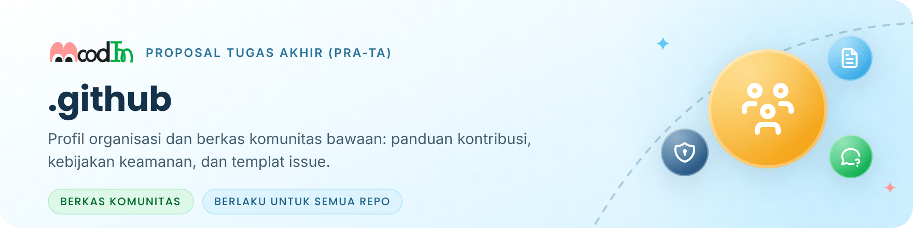

<picture>
  <source media="(prefers-color-scheme: dark)" srcset="profile/assets/banner-github-dark.png">
  
</picture>

Repositori ini mengatur dua hal untuk organisasi [MoodInBME](https://github.com/MoodInBME): **halaman profil** yang tampil di beranda organisasi, dan **berkas komunitas bawaan** yang otomatis berlaku di setiap repositori MoodIn yang tidak punya versinya sendiri. Dengan begitu, aturan kontribusi, cara melapor masalah keamanan, dan templat _issue_ cukup dirawat di satu tempat.

MoodIn sendiri adalah cermin pintar untuk mengenali suasana hati dan tingkat stres, yang saat ini dikembangkan sebagai Proposal Tugas Akhir (Pra-TA) di Departemen Teknik Biomedik ITS. Penjelasan lengkapnya ada di [halaman organisasi](https://github.com/MoodInBME).

## Isi

| Berkas                                                                 | Fungsi                                                                                                                |
| ---------------------------------------------------------------------- | --------------------------------------------------------------------------------------------------------------------- |
| [`profile/README.md`](profile/README.md)                               | Halaman profil organisasi: tentang MoodIn, alur pemeriksaan, prinsip, peta repositori, dan tim                        |
| [`profile/assets/`](profile/assets/)                                   | Gambar halaman profil dan README ini (banner, ikon, wajah suasana hati) beserta [kreditnya](profile/assets/KREDIT.md) |
| [`CONTRIBUTING.md`](CONTRIBUTING.md)                                   | Status proyek dan aturan kerja: siapa yang membuat commit, format pesan commit, dan isi terlarang                     |
| [`SECURITY.md`](SECURITY.md)                                           | Cara melapor kredensial bocor, data pribadi, atau celah keamanan secara tertutup                                      |
| [`.github/ISSUE_TEMPLATE/`](.github/ISSUE_TEMPLATE/)                   | Templat _issue_: laporan bug, tugas, eksperimen, dan keputusan                                                        |
| [`.github/pull_request_template.md`](.github/pull_request_template.md) | Daftar periksa untuk _pull request_                                                                                   |

> [!NOTE]
> Hanya mahasiswa pengusul (Jeremia) yang membuat commit di repositori MoodIn. _Issue_ boleh dibuka siapa saja untuk melaporkan error, tautan mati, atau pertanyaan; laporan keamanan mengikuti [SECURITY.md](SECURITY.md).

---

Departemen Teknik Biomedik · Fakultas Teknologi Elektro dan Informatika Cerdas (FTEIC) · Institut Teknologi Sepuluh Nopember

